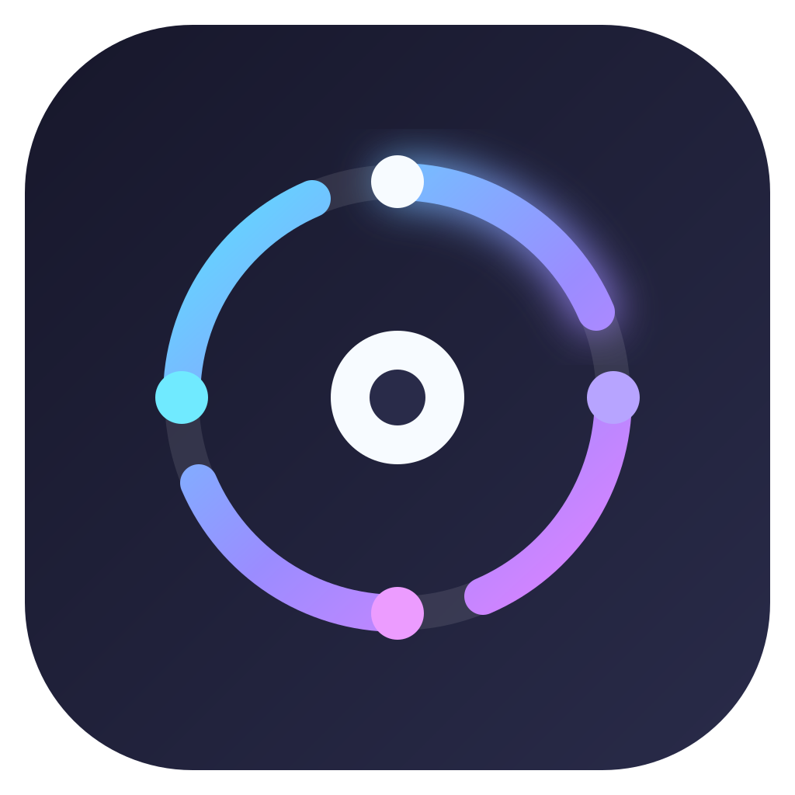
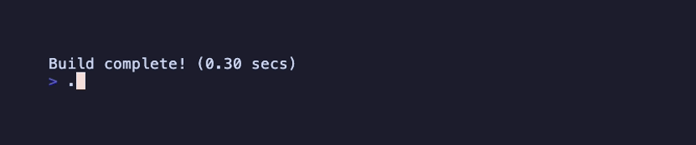

# mac-spinner



[](https://github.com/stephenlclarke/mac-spinner/actions/workflows/ci.yml)
[](https://github.com/stephenlclarke/mac-spinner/actions/workflows/codeql.yml)
[](https://github.com/stephenlclarke/mac-spinner/releases)
[](https://sonarcloud.io/summary/new_code?id=stephenlclarke_mac-spinner)
[](https://sonarcloud.io/summary/new_code?id=stephenlclarke_mac-spinner)
[](https://sonarcloud.io/summary/new_code?id=stephenlclarke_mac-spinner)
[](https://sonarcloud.io/summary/new_code?id=stephenlclarke_mac-spinner)
[](https://sonarcloud.io/summary/new_code?id=stephenlclarke_mac-spinner)
[](https://sonarcloud.io/summary/new_code?id=stephenlclarke_mac-spinner)
[](https://sonarcloud.io/summary/new_code?id=stephenlclarke_mac-spinner)
[](https://sonarcloud.io/summary/new_code?id=stephenlclarke_mac-spinner)
[](https://sonarcloud.io/summary/new_code?id=stephenlclarke_mac-spinner)
[](https://sonarcloud.io/summary/new_code?id=stephenlclarke_mac-spinner)
[](https://sonarcloud.io/summary/new_code?id=stephenlclarke_mac-spinner)
[](https://sonarcloud.io/summary/new_code?id=stephenlclarke_mac-spinner)
[](LICENSE)

A small native macOS spinner for shell scripts. It keeps the spinner in a separate process, so the command output can be captured without disturbing the animation.



## Install

```sh
brew install stephenlclarke/tap/mac-spinner
```

Homebrew downloads the prebuilt release binary for Apple Silicon or Intel Macs.

## Use

```sh
mac-spinner --message "Waiting for jobs" --spin-only
```

Print a pending or completed status row:

```sh
mac-spinner --message "Building" --pending
mac-spinner --message "Build complete" --done
```

Run a command and direct its combined standard output and error to a file:

```sh
mac-spinner --message "Running checks" --output /tmp/checks.log -- make check
```

The [repeater.sh example](examples/repeater.sh) reruns a command on an interval and uses mac-spinner for its interactive countdown. It accepts a command and its arguments without requiring shell quoting:

```sh
./examples/repeater.sh -p 10 -- docker ps
```

`--spin-only` runs until interrupted. In a non-interactive output stream, the program prints one pending row and waits without emitting terminal control codes. Set `SCRIPT_COLOUR=off` to disable colour.

## Build and quality checks

Requires Swift 6.0 and macOS 13 or later.

```sh
make build
make test
make coverage
make leak-check
```

CI runs the tests with Swift coverage instrumentation and fails below 80% source line coverage. It also runs Apple's `leaks` tool against the live spinner process. SonarQube Cloud imports the same coverage report. Regenerate the app icon with `make icon` and the 80-column VHS demo with `make demo`.

## License

MIT. See [LICENSE](LICENSE).
